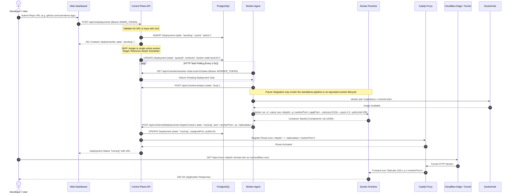
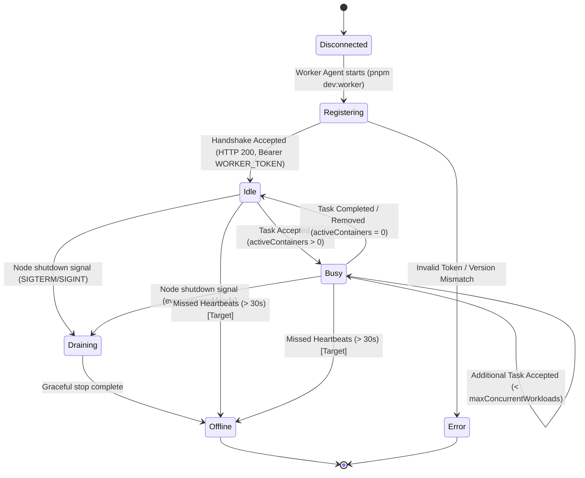
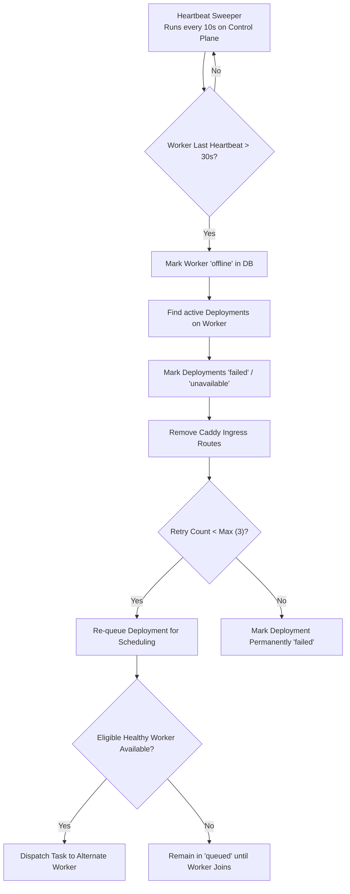
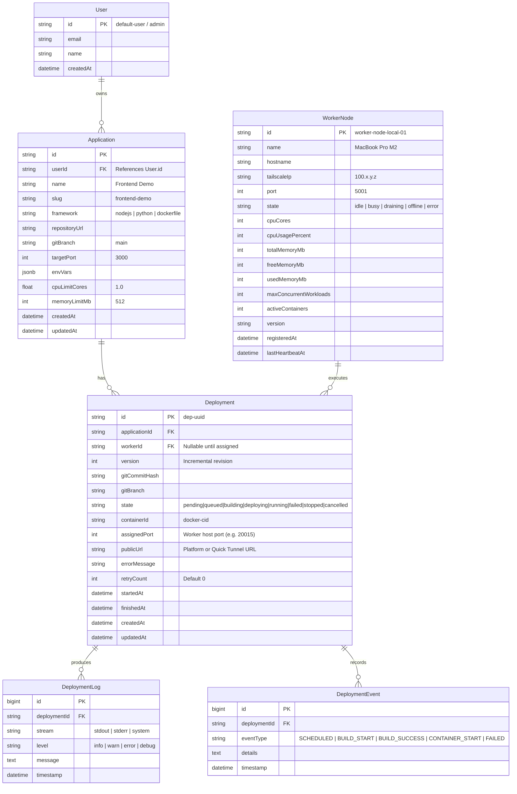
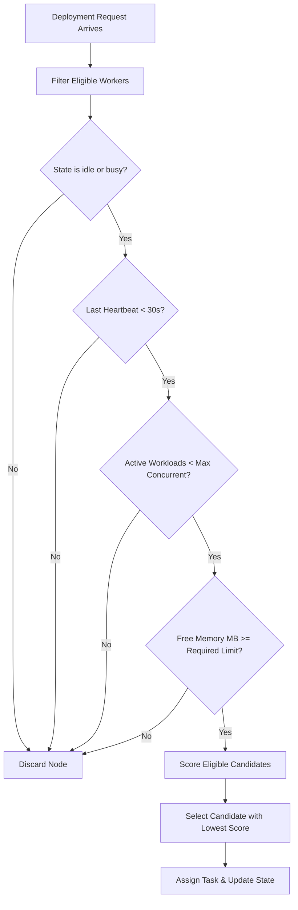

# System Architecture: Cloud without Clouds

**Cloud without Clouds** is a distributed application hosting platform that orchestrates and deploys containerized web applications onto developer-owned laptops and workstations.

This document describes the system architecture, component boundaries, networking topology, data models, API contracts, failure recovery models, and the phased implementation plan for a four-person hackathon team.

---

## 1. System Overview

Developers frequently spend money on hyperscaler cloud virtual machines (EC2, droplets) for dev environments, previews, and hobby projects. Meanwhile, developer workstations possess abundant idle CPU, RAM, and SSD storage.

**Cloud Without Clouds** federates these personal devices into an encrypted, distributed compute cluster:
- Users submit a public Git repository containing a `Dockerfile`.
- The **Control Plane** validates the request and schedules the deployment.
- The standalone **Git-to-image pipeline** clones a public branch, builds its Dockerfile, and publishes a commit-tagged image to public Docker Hub. The future **Worker Agent** integration pulls that image and launches it under strict CPU and memory limits.
- Traffic flows to the application container via an edge ingress proxy and a private **Tailscale** overlay network.

### Scope Distinction: Minimum MVP vs. Target Capabilities
- **Minimum MVP Requirement:** Deploying **one** public Git repository containing a Dockerfile onto **one** worker laptop, executing it inside a Docker container under hardcoded CPU and memory caps, and exposing it through an accessible URL (using Cloudflare Tunnel, or a zero-cost Quick Tunnel / Tailscale fallback).
- **Target Capabilities (Planned for Milestone 2):** Multi-worker registration and heartbeats, resource-aware scheduler placement (preferring the least-loaded eligible worker), worker heartbeat lease tracking, and automatic redeployment of workloads onto another healthy worker upon node failure.

### Standalone Git-to-image pipeline

The deployment workstream provides a command-line build boundary in `deploy/build-and-publish.sh`. It accepts a public HTTPS Git URL, a branch, a Docker Hub repository, and optional repository-relative build paths. It resolves the branch tip to a full commit SHA, builds for the local Linux architecture, pushes `<repository>:<commit-sha>` to Docker Hub, streams logs to stderr, and returns a JSON result on stdout. The pushed digest is returned when Docker reports one.

This pipeline is currently standalone. The worker task poller and control plane do not invoke it yet; their existing clone/build lifecycle remains a future integration point. Workers that consume its images must use a compatible architecture and can pull by the SHA tag or digest.

```mermaid
flowchart TD
    subgraph PublicInternet["Public Internet & Edge Ingress"]
        UserBrowser["User / Web Browser"]
        GitHubRepo["Public Git Repository (GitHub)"]
        CFTunnel["Cloudflare Tunnel (cloudflared)<br/>Production: *.domain.dev<br/>Demo Fallback: *.trycloudflare.com"]
        CaddyProxy["Caddy Reverse Proxy<br/>Dynamic Virtual Host Routing"]
    end

    subgraph ControlPlaneCluster["Central Control Plane (Host / Server)"]
        WebDashboard["React Dashboard<br/>apps/web (Port 5173)"]
        API["Express Control Plane API<br/>apps/api (Port 4000)"]
        SchedulerEngine["Scheduler Engine<br/>MVP: Single-Worker Direct<br/>Target: Resource-Aware Least-Loaded"]
        PostgresDB[(PostgreSQL 16<br/>State Persistence)]
        RedisQueue[(Redis 7<br/>Task Queue & Caching)]
    end

    subgraph TailscaleMesh["Encrypted Tailscale Overlay Network (100.x.y.z)"]
        direction LR
        TS_API["Control Plane Node<br/>100.64.0.1"]
        TS_WorkerA["Worker Node A (Laptop 1)<br/>100.64.0.10"]
        TS_WorkerB["Worker Node B (Laptop 2 - Target)<br/>100.64.0.11"]
        TS_API <--> TS_WorkerA
        TS_API <--> TS_WorkerB
        TS_WorkerA <--> TS_WorkerB
    end

    subgraph WorkerLaptopA["Distributed Worker Node A (Developer Laptop)"]
        WorkerAgentA["Worker Agent Daemon<br/>apps/worker (Port 5001)"]
        HealthMonitorA["Health & Metric Monitor<br/>os.cpus / os.freemem"]
        DockerEngineA["Docker Engine Runtime<br/>cgroups CPU/Memory Enforced"]
        ContainerA["App Container<br/>cwc-dep-xyz (:3000 -> :20015)"]
    end

    UserBrowser -->|HTTPS Request| CFTunnel
    CFTunnel -->|Forward Traffic| CaddyProxy
    CaddyProxy -->|Proxy over Tailscale| ContainerA

    UserBrowser -->|Dashboard Interaction| WebDashboard
    WebDashboard -->|REST API (Bearer ADMIN_TOKEN)| API
    API -->|Persist Deployments & Nodes| PostgresDB
    API -->|Queue Deployments & Heartbeats| RedisQueue
    API --> SchedulerEngine

    WorkerAgentA -->|1. Register (Bearer WORKER_TOKEN)| API
    WorkerAgentA -->|2. Periodic Heartbeat (10s)| API
    WorkerAgentA -->|3. Poll Tasks (HTTP Polling)| API
    API -->|Task Payload| WorkerAgentA
    WorkerAgentA -->|4. Clone Source| GitHubRepo
    WorkerAgentA -->|5. Build & Run Sandbox| DockerEngineA
    DockerEngineA --> ContainerA
    WorkerAgentA -->|6. Report Result & Logs| API
```

---

## 2. Component Responsibilities & Trust Boundaries

The system is decomposed into distinct tiers separated by network and trust boundaries:

```mermaid
graph LR
    subgraph UntrustedZone["Untrusted Zone"]
        WebClients["Browser Users"]
        PublicRepos["Public Git Repos"]
    end

    subgraph DMZ["Ingress DMZ"]
        CF["Cloudflare Tunnel / Quick Tunnel"]
        Caddy["Caddy Proxy"]
    end

    subgraph TrustedControlPlane["Trusted Control Plane"]
        API["Control Plane API"]
        DB[(PostgreSQL)]
        Redis[(Redis)]
    end

    subgraph WorkerSandboxes["Semi-Trusted Worker Workstations"]
        Agent["Worker Agent Daemon"]
        Containers["Docker Containers (Untrusted Code)"]
    end

    WebClients -->|HTTPS| CF
    CF --> Caddy
    Caddy -->|Tailscale Only| Containers
    WebClients -->|Dashboard API (ADMIN_TOKEN)| API
    API --> DB
    API --> Redis
    Agent -->|Tailscale/mTLS (WORKER_TOKEN)| API
    Agent --> Containers
    Containers -.->|Blocked from Host Network| Agent
```

### 1. React Web Dashboard (`apps/web`)
- **Technology:** React 18, Vite, TypeScript, Tailwind CSS v4, Lucide React, TanStack Query.
- **Responsibilities:** Renders platform status, worker inventory, deployment submission form, and streaming build/runtime logs.
- **Trust Boundary:** Untrusted public client. All input is validated on the backend via Zod.
- **Authentication:** In MVP, requests pass `Authorization: Bearer <ADMIN_TOKEN>` to authenticate deployment mutations.
- **Implementation Status:** Shell, navigation, mock telemetry cards, and live API health indicator implemented. Deployment and worker forms are placeholders.

### 2. Express Control Plane API (`apps/api`)
- **Technology:** Node.js (ESM), Express 4, TypeScript, Zod.
- **Responsibilities:** Central orchestrator. Validates requests, manages data persistence, authenticates worker registrations and admin operations, maintains heartbeat leases, executes scheduling calculations, and coordinates ingress route generation.
- **Trust Boundary:** Trusted authority managing cluster state.
- **Implementation Status:** Base Express server, CORS, request logging, centralized error handling, and `/health` route implemented. Feature routes return stubs.

### 3. PostgreSQL Database
- **Technology:** PostgreSQL 16 Alpine (managed locally via Docker Compose in `docker-compose.yml`).
- **Responsibilities:** Durable source of truth for applications, deployment records, worker inventory, and audit events.
- **Trust Boundary:** Trusted data store. Accessible only by the Control Plane.
- **Implementation Status:** Container definition and healthchecks operational; ORM integration and schema migration pending.

### 4. Redis Cache & Queue
- **Technology:** Redis 7 Alpine (managed locally via Docker Compose in `docker-compose.yml`).
- **Responsibilities:** Ephemeral worker heartbeat keys (with TTLs for automatic failure expiration), deployment job queues (target milestone), and pub/sub channels for live log streaming.
- **Trust Boundary:** Trusted private cache. Accessible only by the Control Plane.
- **Implementation Status:** Container definition and healthchecks operational; client connection pending.

### 5. Worker Agent Daemon (`apps/worker`)
- **Technology:** Node.js (ESM), TypeScript, Zod, native `os` APIs.
- **Responsibilities:** Runs as a host daemon on developer laptops. Measures host CPU load and available RAM, connects to the control plane, polls deployment tasks, pulls a published image from Docker Hub in the integrated flow, and monitors running containers. The current worker build engine remains a placeholder; the standalone clone/build/publish boundary is documented above.
- **Trust Boundary:** Semi-trusted execution host. Authenticates using `WORKER_SECRET_TOKEN`. Reported resource usage is sanity-checked by the control plane.
- **Implementation Status:** Host metric collection (`WorkerHealthMonitor`), configuration parser (`workerEnv`), and Docker initialization stub implemented. Heartbeat transmission and Docker build engine are placeholders.

### 6. Docker Runtime Engine
- **Technology:** Docker Engine / Docker Desktop on host machines.
- **Responsibilities:** Sandboxed container creation, filesystem isolation, network port mapping, and kernel-level resource capping (`--memory`, `--cpus`, `--pids-limit`).
- **Trust Boundary:** Untrusted code execution sandbox. Containers run with dropped capabilities and must never access `/var/run/docker.sock`.
- **Implementation Status:** Abstraction layer stubbed in `apps/worker/src/modules/docker/engine.ts`.

### 7. Tailscale Overlay Network
- **Technology:** Tailscale (WireGuard-based mesh).
- **Responsibilities:** Provides secure peer-to-peer routing between the central control plane / ingress proxy and worker laptops located behind domestic NATs and firewalls.
- **Trust Boundary:** Trusted private network (`100.x.y.z`). Worker ports are bound exclusively to the Tailscale interface.
- **Implementation Status:** Automated installation script provided in `deploy/setup-tailscale.sh`.

### 8. Caddy Reverse Proxy
- **Technology:** Caddy v2 (open source).
- **Responsibilities:** Dynamically routes incoming HTTP/HTTPS requests from the edge to the correct worker's Tailscale IP and container port. Supports hot reload via Caddyfile or Caddy Admin API.
- **Trust Boundary:** Trusted reverse proxy.
- **Implementation Status:** Agreed architecture design; deployment configuration pending.

### 9. Cloudflare Tunnel (`cloudflared`) & Zero-Cost Demo Fallbacks
- **Technology:** Cloudflare Zero Trust Tunnel (free tier).
- **Domain & URL Requirements:**
  - Cloudflare Tunnel is free to operate (`cloudflared`).
  - Production-style wildcard URLs (`https://<app>-<id>.<domain>`) require DNS ownership of a custom registered domain configured on Cloudflare.
  - **No Domain Assumption:** The team does not assume a custom domain is available.
  - **Zero-Cost Fallback 1 (Quick Tunnel):** `cloudflared tunnel --url http://localhost:8080` provides a free, temporary `*.trycloudflare.com` public URL with zero domain setup.
  - **Zero-Cost Fallback 2 (Tailscale MagicDNS / IP):** Access directly over the Tailscale network (`http://100.x.y.z:<port>`) for all connected team members.
- **Implementation Status:** Agreed architecture design; tunnel definition pending.

---

## 3. End-to-End Deployment Lifecycle



### Lifecycle State Machine

A deployment progresses through deterministic states (defined in `packages/shared/src/deployment.ts`):

```text
               ┌───────────┐
               │  pending  │ (Record created in API)
               └─────┬─────┘
                     │ (Worker assigned: direct for MVP / scheduled for Target)
               ┌─────▼─────┐
               │  queued   │ (Assignment dispatched to worker task queue)
               └─────┬─────┘
                     │ (Worker polls task & begins clone)
               ┌─────▼─────┐
               │ building  │ (Docker image build in progress)
               └─────┬─────┘
                     │ (Build succeeded, container starting)
               ┌─────▼─────┐
               │ deploying │ (Port binding & ingress routing)
               └─────┬─────┘
                     │ (Container healthy & routing live)
               ┌─────▼─────┐
               │  running  │ (Serving HTTP/HTTPS traffic)
               └───┬───┬───┘
                   │   │
     (Stop invoked)│   │ (Worker crash / healthcheck failure)
                   │   └───┐
            ┌──────▼──┐ ┌──▼──────┐
            │ stopped │ │ failed  │
            └─────────┘ └───┬─────┘
                            │ (Target scheduler triggers failover)
                            └──► [ Re-enters queued on alternate worker ]
```

---

## 4. Worker Lifecycle & Telemetry



### 1. Registration & Authentication
- When `apps/worker` boots, it reads `WORKER_ID`, `WORKER_SECRET_TOKEN`, and `CONTROL_PLANE_URL` from its environment.
- It performs an initial system resource scan (CPU cores, RAM total/free) and sends a `POST /api/v1/workers/register` payload with `Authorization: Bearer <WORKER_SECRET_TOKEN>`.
- The control plane validates `authToken` against its configured secret, verifies protocol version compatibility (`0.1.0`), and records the worker as `idle`.

### 2. Heartbeat Telemetry Loop
- Every 10 seconds, the worker issues `POST /api/v1/workers/heartbeat`.
- **Payload (`WorkerHeartbeatSchema`):** `workerId`, `state`, `resources` (`cpuCount`, `cpuUsagePercent`, `totalMemoryMb`, `freeMemoryMb`, `usedMemoryMb`, `activeContainers`), `activeWorkloadIds`, `timestamp`.
- The control plane records the heartbeat timestamp in Redis (`SET worker:last_seen:<id> <timestamp> EX 35`) and updates PostgreSQL.

### 3. Graceful Disconnect vs. Timeout
- **Graceful Shutdown (`SIGINT` / `SIGTERM`):**
  - Worker transitions state to `draining`.
  - Notifies control plane via `POST /api/v1/workers/status`.
  - Containers are stopped with `docker stop -t 10`.
  - State is set to `offline`.
- **Uncontrolled Crash / Network Drop (Target Feature):**
  - If the control plane misses heartbeats for 30 consecutive seconds (3 intervals), the worker lease expires in Redis.
  - The control plane transitions the worker state to `offline`.

---

## 5. Failure Detection & Target Self-Healing Recovery

> [!NOTE]
> Automatic failure detection and rescheduling are **Target Capabilities** (Milestone 2). The minimum MVP focuses on single-worker execution. The recovery architecture is specified below for parallel implementation.



### Self-Healing Policies (Target)
1. **Heartbeat Sweeper:** The API runs a lightweight scheduled timer (every 10s) checking for workers with `lastHeartbeatAt < NOW() - 30 seconds`.
2. **Workload Eviction:** When a worker is declared `offline`, all deployments mapped to that worker are updated to `failed` with error message `Worker heartbeat timeout`.
3. **Redeployment onto Alternate Worker:** If retries remain ($< 3$), the scheduler re-evaluates candidate workers and re-queues the deployment onto an eligible healthy worker.
4. **Preventing Split-Brain Deployments:**
   - The previous deployment record is marked `cancelled` or `failed` before launching a new attempt.
   - If the disconnected worker reconnects later, the control plane instructs it to terminate any containers not currently assigned to it.
5. **No Worker Available:**
   - If no healthy worker satisfies resource requirements, the deployment remains in state `queued`.
   - When a worker registers or reports free resources, a scheduler trigger sweeps the `queued` pool.

---

## 6. Networking & Ingress Architecture

Public users connect to applications hosted on private residential laptops through a 3-layer network bridge:

```text
[ Client Browser ]
        │  HTTPS (Port 443)
        ▼
[ Cloudflare Edge ]
        │  Production: *.domain.dev (Requires Domain)
        │  Demo Fallback: *.trycloudflare.com (Zero-Cost Quick Tunnel)
        ▼
[ Ingress Host / Control Plane ]
    ├── cloudflared daemon
    │       │  HTTP (localhost:8080)
    │       ▼
    └── Caddy Reverse Proxy
            │  Proxy to Tailscale IP (100.x.y.z:<port>)
            ▼
[ Encrypted Tailscale WireGuard Overlay ]
            │
            ▼
[ Developer Laptop (Worker Node) ]
    └── Docker Bridge Network
            │  Port Forwarding (host:<port> -> container:3000)
            ▼
        [ App Container ]
```

### Ingress Configuration & Fallback Matrix

| Mode | Domain Requirement | Ingress Mechanism | URL Format | Use Case |
| :--- | :--- | :--- | :--- | :--- |
| **Production-Style Setup** | Registered Domain on Cloudflare | Named Cloudflare Tunnel + Caddy dynamic virtual hosts | `https://<app>-<depId>.<domain>` | Production & showcase deployment |
| **Quick Tunnel (Recommended Fallback)** | **None (Zero Cost)** | `cloudflared tunnel --url http://localhost:8080` | `https://<random-slug>.trycloudflare.com` | Hackathon demo without custom domain |
| **Tailscale Private Mesh** | **None (Zero Cost)** | Tailscale MagicDNS / 100.x.y.z direct routing | `http://<worker-host>.tailnet.ts.net:<port>` | Internal team evaluation & testing |
| **Localhost Demo** | **None (Zero Cost)** | Direct host port binding | `http://localhost:<assignedPort>` | Local single-machine testing |

---

## 7. Data Model & Storage Specifications

The database schema is modeled for PostgreSQL. Below is the proposed entity-relationship specification to be implemented in `apps/api`:



> [!NOTE]
> **Status:** The schema above is the **proposed** relational model for PostgreSQL. The types in `packages/shared/src/` (`AppConfig`, `Deployment`, `WorkerNode`) define the canonical JSON transfer representations used by the API and clients.

---

## 8. API Boundaries & Endpoint Contracts

All endpoints accept and return `application/json`. Data models reuse schemas from `packages/shared`.

### Endpoint Summary Matrix

| Method | Path | Status | Auth Required | Description |
| :--- | :--- | :--- | :--- | :--- |
| `GET` | `/health` | **Implemented** | None | Health check & dependency verification |
| `GET` | `/api/v1/workers` | **Implemented** (stub) | Admin Token / Dev | List all registered worker nodes and resource states |
| `POST` | `/api/v1/workers/register` | **Proposed** | `WORKER_SECRET_TOKEN` | Register a new worker node with host specs |
| `POST` | `/api/v1/workers/heartbeat` | **Proposed** | `WORKER_SECRET_TOKEN` | Periodic telemetry, resource usage, active tasks |
| `POST` | `/api/v1/workers/status` | **Proposed** | `WORKER_SECRET_TOKEN` | Explicit state transition (e.g. draining, error) |
| `GET` | `/api/v1/workers/:id/tasks` | **Proposed** | `WORKER_SECRET_TOKEN` | Worker polls for pending deployment tasks (MVP) |
| `GET` | `/api/v1/deployments` | **Implemented** (stub) | Admin Token / Dev | List deployments with optional filters |
| `POST` | `/api/v1/deployments` | **Proposed** | `ADMIN_TOKEN` | Submit a Git repo for deployment |
| `GET` | `/api/v1/deployments/:id` | **Proposed** | Admin Token / Dev | Get deployment details, assigned worker, and URL |
| `GET` | `/api/v1/deployments/:id/logs` | **Proposed** | Admin Token / Dev | Retrieve deployment build and execution logs |
| `POST` | `/api/v1/deployments/:id/cancel` | **Proposed** | `ADMIN_TOKEN` | Terminate an active deployment |
| `POST` | `/api/v1/internal/deployments/:id/result` | **Proposed** | `WORKER_SECRET_TOKEN` | Worker reports container start or build failure |

---

### Detailed Contract Specifications

#### 1. Worker Task Polling (MVP Dispatch Mechanism)
- **Route:** `GET /api/v1/workers/:id/tasks`
- **Headers:** `Authorization: Bearer <WORKER_SECRET_TOKEN>`
- **Response (200 OK — Task Available):**
  ```json
  {
    "success": true,
    "hasTask": true,
    "task": {
      "deploymentId": "dep-018e3a2b",
      "applicationId": "app-7712",
      "git": {
        "repositoryUrl": "https://github.com/cloud-without-clouds/demo-node-app.git",
        "branch": "main",
        "rootDirectory": "/"
      },
      "targetPort": 3000,
      "resourceLimits": {
        "cpuLimitCores": 1.0,
        "memoryLimitMb": 512
      },
      "env": [
        { "key": "NODE_ENV", "value": "production", "isSecret": false }
      ]
    }
  }
  ```
- **Response (200 OK — No Task):**
  ```json
  {
    "success": true,
    "hasTask": false
  }
  ```

#### 2. Worker Reports Deployment Result
- **Route:** `POST /api/v1/internal/deployments/:id/result`
- **Headers:** `Authorization: Bearer <WORKER_SECRET_TOKEN>`
- **Request Body:**
  ```json
  {
    "deploymentId": "dep-018e3a2b",
    "workerId": "worker-node-local-01",
    "state": "running",
    "containerId": "a1b2c3d4e5f6",
    "assignedPort": 20015,
    "publicUrl": "https://random-words.trycloudflare.com",
    "errorMessage": null
  }
  ```
- **Response (200 OK):**
  ```json
  {
    "success": true,
    "acknowledged": true
  }
  ```

#### 3. Create Deployment
- **Route:** `POST /api/v1/deployments`
- **Headers:** `Authorization: Bearer <ADMIN_TOKEN>`
- **Request Body:**
  ```json
  {
    "name": "Node Express Demo",
    "slug": "node-express-demo",
    "framework": "dockerfile",
    "git": {
      "repositoryUrl": "https://github.com/cloud-without-clouds/demo-node-app.git",
      "branch": "main",
      "rootDirectory": "/"
    },
    "port": 3000,
    "env": [
      { "key": "NODE_ENV", "value": "production", "isSecret": false }
    ],
    "resourceLimits": {
      "cpuLimitCores": 1.0,
      "memoryLimitMb": 512
    }
  }
  ```
- **Response (201 Created):**
  ```json
  {
    "success": true,
    "data": {
      "id": "dep-018e3a2b",
      "applicationId": "app-7712",
      "version": 1,
      "gitBranch": "main",
      "state": "pending",
      "createdAt": "2026-10-31T16:02:00.000Z",
      "updatedAt": "2026-10-31T16:02:00.000Z"
    }
  }
  ```

---

## 9. Resource-Aware Scheduling Logic (Target Capability)

> [!NOTE]
> The single-worker MVP routes deployments directly to the single active worker. When multiple workers are connected (Target Capability), the scheduler executes the placement algorithm specified below.



### Eligibility Filters
A candidate worker $W$ is eligible if and only if all of the following conditions are met:
1. $W.\text{state} \in \{\text{'idle'}, \text{'busy'}\}$
2. $\text{now}() - W.\text{lastHeartbeatAt} \le 30\text{ seconds}$
3. $W.\text{resources.activeContainers} < W.\text{limits.maxConcurrentWorkloads}$
4. $W.\text{resources.freeMemoryMb} \ge D.\text{resourceLimits.memoryLimitMb}$

### Placement Scoring Formula
Among all eligible candidate workers, the scheduler selects the worker with the lowest **Load Score** $S(W)$, preferring the least-loaded worker:

$$S(W) = \left( 0.4 \times \frac{W.\text{resources.usedMemoryMb}}{W.\text{resources.totalMemoryMb}} \right) + \left( 0.4 \times \frac{W.\text{resources.cpuUsagePercent}}{100} \right) + \left( 0.2 \times \frac{W.\text{resources.activeContainers}}{W.\text{limits.maxConcurrentWorkloads}} \right)$$

- **Tie-Breaking:** If two workers produce identical scores within $1\%$, select the worker with the highest `freeMemoryMb`.
- **Exhaustion Behavior:** If no worker satisfies the eligibility filters, the deployment remains in state `queued` and is re-evaluated upon the next worker registration or heartbeat.

---

## 10. Observability: Logs, Events, and Metrics

1. **Log Streaming:**
   - Worker captures stdout/stderr streams from `docker build` and running containers via Docker Engine API (`docker logs -f --tail 100`).
   - Log entries match `DeploymentLogEntrySchema` (`timestamp`, `level`, `message`, `stream`).
   - For MVP, the worker flushes log batches to the control plane via `POST /api/v1/deployments/:id/logs`.
   - The React frontend polls `GET /api/v1/deployments/:id/logs` (with target upgrade to Server-Sent Events or WebSockets).
2. **Deployment Event History:**
   - Discrete audit events recorded in `DeploymentEvent` (`SCHEDULED`, `CLONED`, `BUILD_FAILED`, `HEALTHY`, `TERMINATED`).
3. **Host Metrics Telemetry:**
   - Host metrics (`cpuUsagePercent`, `freeMemoryMb`, `usedMemoryMb`) are pushed with every 10-second worker heartbeat.

---

## 11. Security Considerations & Threat Modeling

| Threat Vector | Severity | Mitigation Architecture |
| :--- | :--- | :--- |
| **Malicious Repository Code Escape** | Critical | Docker container isolation. No volume mounts to host filesystem paths (`/etc`, `/home`). Do not run with `--privileged`. Drop Linux capabilities (`--cap-drop=ALL`). |
| **Host Workstation Memory Exhaustion** | High | Hard container memory limits enforced via Docker cgroups (`--memory 512m --memory-swap 512m`). If container exceeds limit, it is OOM-killed without crashing the host OS. |
| **Fork Bombs & Process Exhaustion** | High | Enforce `--pids-limit 256` on every container invocation. |
| **Direct Exposure of Worker Home IPs** | High | Inbound traffic routed over encrypted Tailscale mesh (`100.x.y.z`). Containers bind to the Tailscale interface only. Domestic router ports remain closed. |
| **Control Plane API Tampering** | Medium | Strict Zod validation. Protected endpoints require `ADMIN_TOKEN` or `WORKER_SECRET_TOKEN` bearer tokens. |
| **Ingress Route Manipulation** | Medium | Ingress routes managed centrally by the Control Plane. Workers cannot register routes for arbitrary domains. |

---

## 12. Implementation Phasing: MVP vs. Target

| Capability / Feature | Currently Implemented | Agreed MVP Demo | Target Platform | Out of Scope |
| :--- | :---: | :---: | :---: | :---: |
| Monorepo & Shared Types | ✅ Yes | ✅ Yes | ✅ Yes | - |
| Docker Compose (Postgres/Redis) | ✅ Yes | ✅ Yes | ✅ Yes | - |
| Control Plane Base API & /health | ✅ Yes | ✅ Yes | ✅ Yes | - |
| Worker Host Metrics & Stubs | ✅ Yes | ✅ Yes | ✅ Yes | - |
| Frontend Shell & Navigation | ✅ Yes | ✅ Yes | ✅ Yes | - |
| Git-to-Docker Hub Build Pipeline | ✅ Yes (`deploy/build-and-publish.sh`) | ✅ Yes | ✅ Yes | - |
| Single Worker Image Pull & Container Run | ❌ No | ✅ Yes | ✅ Yes | - |
| Container Port Binding & CPU/Mem Capping | ❌ No | ✅ Yes | ✅ Yes | - |
| Platform URL via Cloudflare/Quick Tunnel | ❌ No | ✅ Yes | ✅ Yes | - |
| Web Deployment Creation UI | ❌ No | ✅ Yes | ✅ Yes | - |
| MVP Bearer Auth (Admin & Worker Tokens) | ❌ No | ✅ Yes | ✅ Yes | - |
| Worker Task Polling Dispatch (HTTP) | ❌ No | ✅ Yes | ✅ Yes | - |
| Multi-Worker Registration & Heartbeats | ❌ No | ❌ No | ✅ Yes | - |
| Least-Loaded Resource Scheduler | ❌ No | ❌ No | ✅ Yes | - |
| Worker Heartbeat Timeout & Rescheduling | ❌ No | ❌ No | ✅ Yes | - |
| Live Log Streaming (SSE / WebSockets) | ❌ No | ❌ No | ✅ Yes | - |
| Multi-Replica Deployment per App | ❌ No | ❌ No | ❌ No | 🚫 Out of Scope |
| Custom Domain DNS Automation | ❌ No | ❌ No | ❌ No | 🚫 Out of Scope |
| Private Git Repositories (SSH/OAuth) | ❌ No | ❌ No | ❌ No | 🚫 Out of Scope |
| Kubernetes / Nomad Integration | ❌ No | ❌ No | ❌ No | 🚫 Out of Scope |
| Paid Cloud Hyperscaler Infrastructure | ❌ No | ❌ No | ❌ No | 🚫 Out of Scope |

---

## 13. Decided Architectural Specifications

All foundational architectural decisions have been formally resolved for the hackathon team:

### 1. MVP Authentication Model
- **Mechanism:** Pre-shared bearer token model.
- **User / Admin Operations:** `POST /api/v1/deployments` and `POST /api/v1/deployments/:id/cancel` require an `Authorization: Bearer <ADMIN_TOKEN>` header matching `ADMIN_TOKEN` in `.env`. The control plane maps this to a default administrator record (`admin` / `default-user`).
- **Worker Node Operations:** Worker endpoints (`/api/v1/workers/register`, `/api/v1/workers/heartbeat`, `/api/v1/workers/status`, `/api/v1/workers/:id/tasks`, `/api/v1/internal/...`) require `Authorization: Bearer <WORKER_SECRET_TOKEN>`.
- **Public Endpoints:** `GET /health` is unauthenticated.
- **Post-MVP:** Multi-tenant user accounts and OAuth login (GitHub/Google) are deferred to future milestones.

### 2. Worker Task Dispatch Model
- **Mechanism:** Pull-based **HTTP Polling** using standard Node.js `fetch` in `apps/worker`.
- **Workflow:**
  1. Worker polls `GET /api/v1/workers/:id/tasks` every 2–5 seconds (or inspects the heartbeat response).
  2. If a deployment task is pending, the worker receives a `DeploymentTaskPayload` (deployment ID, git URL, branch, port, resource caps).
  3. The standalone pipeline clones the requested branch, builds the Dockerfile, and publishes `<repository>:<commit-sha>` to Docker Hub. Future worker integration acknowledges receipt, pulls that image, and starts the container.
  4. Worker reports results (`containerId`, `assignedPort`, `status: running | failed`) via `POST /api/v1/internal/deployments/:id/result`.
- **Infrastructure:** Zero additional message broker needed for MVP; Redis remains available in `docker-compose.yml` for target BullMQ queues.

### 3. Database ORM Layer (Control Plane)
- **Selected Standard:** **Drizzle ORM** (`drizzle-orm` + `drizzle-kit` with `pg` driver).
- **Rationale:** TypeScript-first, zero-overhead query builder, lightning-fast compilation, and seamless integration with existing Zod schemas (`drizzle-zod`).
- **Implementation Guideline:** Define table schemas in `apps/api/src/db/schema.ts` and generate SQL migrations using `drizzle-kit generate`.

### 4. Edge Ingress & Reverse Proxy Synchronization
- **Selected Standard:** **Caddy Admin API (`POST http://localhost:2019/load`)** + **Cloudflare Quick Tunnel Fallback**.
- **Workflow:** When a container is reported `running`, the control plane API issues a programmatic JSON config update to Caddy's REST Admin API on `localhost:2019` to register the new upstream (`<app-slug>-<depId>.<domain>` $\rightarrow$ `<worker-tailscale-ip>:<assignedPort>`).
- **Demo Fallback (No Custom Domain):** When a custom domain is unavailable, the team uses **Cloudflare Quick Tunnel** (`cloudflared tunnel --url http://localhost:<port>`) for instant zero-cost public HTTPS (`*.trycloudflare.com`), or direct Tailscale MagicDNS routing.

### 5. Container Host Port Allocation (Worker)
- **Selected Standard:** **Docker Ephemeral Port Binding (`-p 0:<appPort>`)**.
- **Workflow:** When launching a container, `apps/worker` passes `-p 0:<targetPort>` (e.g. `docker run -d -p 0:3000 ...`). The host OS kernel and Docker daemon automatically assign an available unprivileged host port (typically between 32768–60999), completely eliminating port collisions, race conditions, and static port range tracking.
- **Port Discovery:** Worker immediately inspects the container:
  ```bash
  docker inspect --format '{{(index (index .NetworkSettings.Ports "3000/tcp") 0).HostPort}}' <containerId>
  ```
  The worker extracts the assigned port and reports it back to the control plane in `POST /api/v1/internal/deployments/:id/result`.
