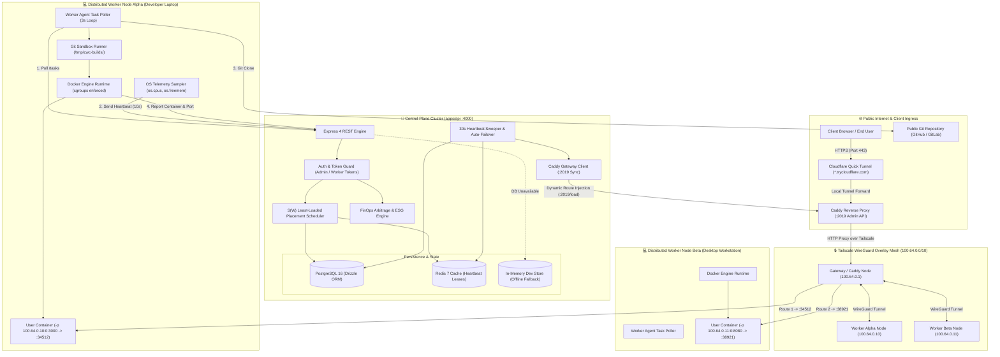
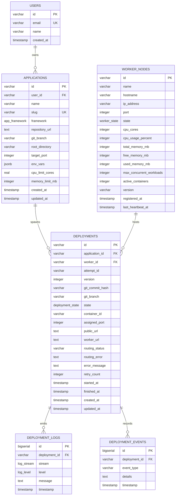
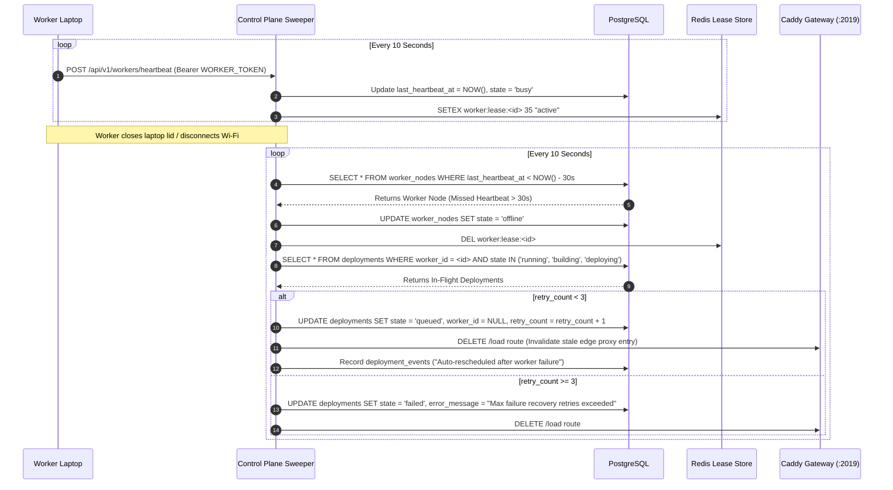

# Cloud Without Clouds: Comprehensive System Architecture Specification

> **Classification:** Technical Architecture & Systems Engineering Specification  
> **Document Purpose:** Complete, exhaustive structural and behavioral reference of the entire Cloud Without Clouds platform for system architects, engineering contributors, and diagram visualizers.  
> **Repository:** `cloud-without-clouds` (Monorepo: pnpm workspaces + Turborepo)

---

## 1. Executive Architectural Overview & Core Thesis

**Cloud Without Clouds** is a decentralized, zero-cloud-bill application hosting platform. It clusters developer-owned laptops and desktop workstations into a unified compute mesh capable of ingesting public Git repositories, building containerized workloads, scheduling them onto optimal host silicon, providing private encrypted overlay networking, and routing public HTTPS edge traffic directly to local containers without public IP addresses or port forwarding.

### Core Architectural Axioms
1. **Zero Infrastructure Cost:** Complete operational independence from hyperscaler cloud instances (AWS EC2, GCP Compute Engine, Azure VMs). Workloads run on repurposed, developer-owned workstation silicon.
2. **Untrusted Node Containment:** Worker nodes run arbitrary user-submitted application code. Every execution boundary is strictly isolated via Linux kernel cgroups, resource quotas (CPU, memory, process IDs), non-root contexts, and ephemeral build paths.
3. **Carrier-Grade Private Mesh:** Control Plane and worker agents communicate over an encrypted Tailscale WireGuard overlay (`100.64.0.0/10`), bypassing home/office NAT, dynamic IPs, and restrictive firewalls.
4. **Dynamic Ephemeral Port Orchestration:** Containers bind to host port `0` on the private Tailscale interface (`-p <tailscale-ip>:0:<app-port>`). The host kernel allocates an ephemeral collision-free port which is reported back to the Control Plane for reverse proxy synchronization.
5. **Continuous Self-Healing Fabric:** Automatic heartbeat leases (10s interval, 30s timeout) trigger automated sweeper routines that evict offline nodes, release proxy routing slots, and re-enqueue in-flight workloads to healthy peers.

---

## 2. Monorepo Structure & Package Topology

The repository is organized as a high-cohesion, low-coupling monorepo managed via **pnpm workspaces** and **Turborepo** (`turbo.json`).

```text
cloud-without-clouds/
├── apps/
│   ├── api/                     # Central Control Plane REST API (@cloud-without-clouds/api)
│   │   ├── src/
│   │   │   ├── cache/           # Redis 7 cache & lease management (ioredis)
│   │   │   ├── config/          # Environment configuration with Zod validation
│   │   │   ├── db/              # Drizzle ORM schema, migrations & in-memory dev store
│   │   │   ├── middlewares/     # Auth, error handling, request logging, 404
│   │   │   ├── routes/          # Express route controllers (deployments, workers, finops, etc.)
│   │   │   └── services/        # S(W) Scheduler, Sweeper, FinOps calculator, Gateway client
│   │   └── package.json
│   ├── web/                     # React 18 + Vite 6 Dashboard (@cloud-without-clouds/web)
│   │   ├── src/
│   │   │   ├── components/      # UI components (analytics, chaos, deployments, finops, layout)
│   │   │   ├── pages/           # Application views (Dashboard, Equalizer, FinOps, Workers, etc.)
│   │   │   └── services/        # HTTP API client with resilient offline/dev fallback engine
│   │   └── package.json
│   └── worker/                  # Host Node.js Distributed Agent (@cloud-without-clouds/worker)
│       ├── src/
│       │   ├── config/          # Worker configuration and Tailscale detection
│       │   ├── modules/         # Control plane HTTP client & Docker abstractions
│       │   └── services/        # Task poller, deployment runner, Docker engine, metrics sampler
│       └── package.json
├── packages/
│   └── shared/                  # Canonical Domain Models & Contracts (@cloud-without-clouds/shared)
│       ├── src/                 # Pure Zod schemas & inferred TypeScript interfaces
│       └── package.json
├── deploy/                      # Ingress & Networking Automation
│   ├── gateway/                 # Node.js Caddy sync daemon & gateway client
│   ├── caddy-initial.json       # Base Caddy reverse proxy upstream configuration
│   └── setup-tailscale.sh       # Automated Tailscale provisioning script for Ubuntu
├── docker-compose.yml           # Local backing data services (PostgreSQL 16 Alpine, Redis 7 Alpine)
├── package.json                 # Workspace root scripts
├── pnpm-workspace.yaml          # pnpm workspace definition
└── turbo.json                   # Turborepo task pipeline definition
```

---

## 3. End-to-End System Architecture Diagram



---

## 4. Subsystems, Boundaries & Technology Stack

| Subsystem | Package / App | Core Technologies | Strict Boundaries & Invariants |
| :--- | :--- | :--- | :--- |
| **Frontend Dashboard** | `apps/web` | React 18, Vite 6, Tailwind CSS v4, Lucide React, TanStack Query, React Router v6, Recharts | Communicates exclusively with the Control Plane API via HTTP/JSON. Cannot execute Docker commands, access host sockets, or communicate directly with worker laptops. Implements complete client-side simulation fallbacks in `api.ts`. |
| **Control Plane API** | `apps/api` | Node.js (ESM), Express 4, TypeScript, Zod, Drizzle ORM, PostgreSQL 16, Redis 7 | Central orchestration brain. Evaluates placement policies, tracks worker leases, executes heartbeat sweeps, updates Caddy proxy upstreams, and calculates FinOps metrics. Never clones source repos or runs Docker containers itself. |
| **Worker Host Agent** | `apps/worker` | Node.js (ESM), TypeScript, Zod, Docker Engine CLI / SDK, Child Process, OS APIs | Runs as a resident background daemon on personal laptops/workstations. Samples host CPU/memory telemetry, authenticates to control plane, pulls Git code, executes Docker builds, launches containers with cgroup resource caps, and reports assigned ports. |
| **Shared Contracts** | `packages/shared` | TypeScript, Zod, tsup | Single source of truth across all apps. Defines all Zod validation schemas, data types, lifecycle enums, and HTTP payload interfaces. Contains zero runtime business logic or framework dependencies. |
| **Networking Mesh** | Network Layer | Tailscale (WireGuard) | Provides encrypted point-to-point mesh connectivity (`100.x.y.z`) between the Control Plane, Ingress Proxy, and distributed worker nodes across NATs and firewalls without open incoming router ports. |
| **Edge Ingress Proxy** | Ingress Layer | Caddy v2, Cloudflare Quick Tunnel (`cloudflared`) | Caddy dynamically loads upstream proxy routes via its REST Admin API (`:2019`). Cloudflare Quick Tunnel provides a public HTTPS endpoint (`*.trycloudflare.com`) routing external traffic to Caddy. |
| **Persistence Layer** | Infrastructure | PostgreSQL 16 Alpine, Redis 7 Alpine | PostgreSQL stores durable relational entities (workers, apps, deployments, logs, events). Redis manages high-speed heartbeat leases and task queues. |

---

## 5. Data Models, Database Schemas & Persistence

Drizzle ORM defines the relational schema in `apps/api/src/db/schema.ts`.

### 5.1 Relational Entity-Relationship Diagram



### 5.2 Canonical Enums
- `worker_state`: `'idle' | 'busy' | 'draining' | 'offline' | 'error'`
- `deployment_state`: `'pending' | 'queued' | 'building' | 'deploying' | 'running' | 'failed' | 'stopped' | 'cancelled'`
- `app_framework`: `'nodejs' | 'python' | 'static' | 'dockerfile' | 'go'`
- `routing_status`: `'pending' | 'configuring' | 'ready' | 'failed' | 'removed'`
- `log_stream`: `'stdout' | 'stderr' | 'system'`
- `log_level`: `'info' | 'warn' | 'error' | 'debug'`

### 5.3 Attempt Isolation Invariant (`attempt_id`)
To prevent split-brain races where a lagging worker reports on an old assignment that has already been reassigned to a new node, every scheduling action assigns a unique UUID `attempt_id`. The worker must include this token in all reports. If `attempt_id` does not match the active record, the report is rejected.

---

## 6. Networking, Ingress & Ephemeral Port Allocation

### 6.1 Private Mesh Address Invariant
Workers only accept and bind traffic on the validated private Tailscale interface (`100.64.0.0/10`).
- Validated via regex: `^100\.(6[4-9]|[7-9][0-9]|1[0-1][0-9]|12[0-7])\.[0-9]{1,3}\.[0-9]{1,3}$`
- Prevents container ports from binding to public WAN interfaces (`0.0.0.0`), local loopback (`127.0.0.1`), or LAN bridge interfaces.

### 6.2 Docker Ephemeral Port Binding Sequence
```text
[Control Plane] -> Task Payload (targetPort: 3000) -> [Worker Agent]
[Worker Agent]  -> Executes: docker run -d -p 100.64.0.10:0:3000 --memory="512m" ...
[Host Kernel]   -> Automatically allocates free ephemeral port (e.g., 34512)
[Worker Agent]  -> Queries: docker inspect --format='{{(index (index .NetworkSettings.Ports "3000/tcp") 0).HostPort}}'
[Worker Agent]  -> Discovers assigned host port = 34512
[Worker Agent]  -> Reports result: { containerId: "cwc-dep-123", assignedPort: 34512 } -> [Control Plane]
[Control Plane] -> Synthesizes upstream: http://100.64.0.10:34512
[Control Plane] -> Pushes route to Caddy Admin API (:2019/load)
```

### 6.3 Edge Routing & Virtual Host Synthesis
- Public URL structure: `https://<app-slug>-<deployment-id-prefix>.<tunnel-domain>`
- Caddy acts as an internal Layer 7 reverse proxy, matching incoming `Host` headers and reverse-proxying HTTP traffic over the encrypted Tailscale overlay mesh directly to the worker laptop's ephemeral port.

---

## 7. Scheduler Mathematical Model & Policy Engine

The Control Plane scheduler implements an optimal, resource-aware placement policy $S(W)$ that balances workload distribution across personal workstations.

### 7.1 Formal Load Score Formulation
For any candidate worker node $W$, the load score $S(W) \in [0.0, 1.0]$ is computed as:

$$S(W) = 0.4 \times \left(\frac{M_{\text{used}}}{M_{\text{total}}}\right) + 0.4 \times \left(\frac{\text{CPU}_{\%}}{100}\right) + 0.2 \times \left(\frac{C_{\text{active}}}{C_{\text{max}}}\right)$$

Where:
- $M_{\text{used}} / M_{\text{total}}$ is the node's normalized memory utilization ratio.
- $\text{CPU}_{\%} / 100$ is the current CPU load percentage normalized to $[0, 1]$.
- $C_{\text{active}} / C_{\text{max}}$ is the node's active container ratio relative to its concurrency cap.

**Objective:** Select eligible worker $W^*$ such that:
$$W^* = \arg\min_{W \in \mathcal{E}} S(W)$$

### 7.2 4-Tier Hard Eligibility Filtering ($\mathcal{E}$)
Before computing $S(W)$, candidates must pass all 4 eligibility filters:
1. **Node State Gate:** Worker state must be strictly `'idle'` or `'busy'` (rejects `'offline'`, `'draining'`, `'error'`).
2. **Freshness Lease Gate:** Worker last heartbeat must satisfy:
   $$t_{\text{now}} - t_{\text{lastHeartbeat}} \le 30,000\text{ ms}$$
3. **Concurrency Ceiling Gate:** Active container count must be below maximum capacity:
   $$C_{\text{active}} < C_{\text{max}}$$
4. **Memory Headroom Gate:** Worker free memory must satisfy application requested limit:
   $$M_{\text{free}} \ge M_{\text{required}}$$

### 7.3 Cluster Balance & Skew Metric
The cluster resource skew is calculated across all active nodes:
$$\text{Skew} = \left(\max_{W \in \text{Active}} \frac{M_{\text{allocated}}(W)}{M_{\text{total}}(W)} - \min_{W \in \text{Active}} \frac{M_{\text{allocated}}(W)}{M_{\text{total}}(W)}\right) \times 100\%$$
- If $\text{Skew} \le 10\%$, the cluster is flagged as **Balanced**.
- If $\text{Skew} > 10\%$, the **Cluster Equalizer** triggers rebalance migration plans.

---

## 8. Heartbeat Sweeper & Failure Recovery Engine

The Control Plane executes an autonomous background sweeper (`apps/api/src/services/sweeper.ts`) running on a continuous 10-second timer.



---

## 9. FinOps Cost Arbitrage & ESG Carbon Offset Engine

The FinOps calculation engine ([`finops-calculator.ts`](file:///c:/Users/ReniCd/Desktop/Hackathons/BNB_FINAL_2026/apps/api/src/services/finops-calculator.ts)) quantifies the exact financial and environmental value delivered by repurposing idle workstation silicon.

### 9.1 Hyperscaler Pricing Benchmarks (AWS Public Baseline)
- **vCPU Baseline:** $\$12.50$ per vCPU / month (AWS EC2 Linux On-Demand standard).
- **RAM Baseline:** $\$4.25$ per GB RAM / month.
- **Compute Market Value:**
  $$\text{Cost}_{\text{compute}} = (\text{Total vCPUs} \times 12.50) + (\text{Total RAM}_{\text{GB}} \times 4.25)$$
- **Application Load Balancer (ALB):** $\$16.20$ base / month + $\$7.20$ / active route LCU.
- **Egress Bandwidth:** $\$0.09$ / GB standard transfer fee ($\approx \$4.50/\text{route/mo}$).
- **Total Commercial Benchmark:**
  $$\text{Cost}_{\text{hyperscaler}} = \text{Cost}_{\text{compute}} + \text{Cost}_{\text{networking}}$$

### 9.2 Arbitrage & High-Frequency Savings Rates
- **Cloud Without Clouds Cost:** $\$0.00$ / month (Peer compute is already capitalized).
- **Net Monthly Arbitrage:** $\Delta_{\text{monthly}} = \text{Cost}_{\text{hyperscaler}} - \$0.00 = \text{Cost}_{\text{hyperscaler}}$
- **Annual Savings:** $\Delta_{\text{annual}} = \Delta_{\text{monthly}} \times 12$
- **Live Ticker Increment Rate:**
  $$R_{\text{second}} = \frac{\Delta_{\text{monthly}}}{30 \times 24 \times 3600} \quad (\text{USD / second})$$

### 9.3 ESG Sustainability & Carbon Offsetting Model
- **Data Center Power Usage Effectiveness (PUE) & Embodied Silicon Carbon:**
  $$\text{Carbon Offset} = \text{Total RAM}_{\text{GB}} \times 0.507\text{ kg CO}_2/\text{month}$$
- **Annual Mature Trees Equivalent:**
  $$\text{Trees}_{\text{annual}} = \max\left(1, \text{round}\left(\frac{\text{Carbon Offset}_{\text{monthly}} \times 12}{21\text{ kg CO}_2/\text{tree}}\right)\right)$$

### 9.4 Team Scaling Simulation Model ($N$ Nodes)
$$\text{Projected RAM}(N) = \left(\frac{\text{Total RAM}}{\text{Node Count}}\right) \times N, \quad \text{Projected vCPUs}(N) = \left(\frac{\text{Total vCPUs}}{\text{Node Count}}\right) \times N$$
Recalculates monthly and annual budget avoidance dynamically as the user drags the team fleet slider.

---

## 10. Complete API Endpoint Contract Catalog

All API endpoints are validated at runtime using strict Zod schemas.

### 10.1 Public & Health Endpoints
- `GET /health`
  - Auth: None
  - Response: `{ status: "ok", timestamp: string, version: string, database: boolean, redis: boolean }`

### 10.2 Application Management (`/api/v1/applications`)
- `GET /api/v1/applications`: Lists all registered applications.
- `POST /api/v1/applications`: Registers a new application from a Git repository.
  - Body: `{ name: string, repositoryUrl: string, gitBranch?: string, rootDirectory?: string, targetPort?: number, envVars?: Array<{ key: string, value: string, isSecret: boolean }>, resourceLimits?: { memoryLimitMb: number, cpuLimitCores: number } }`
- `GET /api/v1/applications/:id`: Retrieves application metadata and configuration.
- `DELETE /api/v1/applications/:id`: Cascades deletion of application and deployment records.

### 10.3 Deployment Lifecycle (`/api/v1/deployments`)
- `GET /api/v1/deployments`: Lists deployment history with state and routing status.
- `POST /api/v1/deployments`: Enqueues a new deployment task and invokes the $S(W)$ scheduler.
  - Body: `{ applicationId: string, gitBranch?: string, gitCommitHash?: string }`
- `GET /api/v1/deployments/:id`: Retrieves real-time deployment status, container ID, and URLs.
- `GET /api/v1/deployments/:id/logs`: Streams log entries emitted by the workload.
- `POST /api/v1/deployments/:id/cancel`: Cancels an in-flight deployment.

### 10.4 Worker Node Management (`/api/v1/workers`)
- `POST /api/v1/workers/register`: Worker agent registration and capability advertisement.
  - Auth: `Bearer WORKER_SECRET_TOKEN`
  - Body: `{ id: string, name: string, hostname: string, ipAddress: string, port: number, resources: { cpuCount: number, totalMemoryMb: number, freeMemoryMb: number, usedMemoryMb: number }, limits: { maxConcurrentWorkloads: number, maxMemoryMb: number, maxCpuCores: number } }`
- `POST /api/v1/workers/heartbeat`: 10-second worker telemetry update.
  - Auth: `Bearer WORKER_SECRET_TOKEN`
  - Body: `{ workerId: string, state: worker_state, resources: Telemetry, activeWorkloadIds: string[], timestamp: string }`
- `GET /api/v1/workers/:id/tasks`: Pull-based HTTP task poller endpoint.
- `GET /api/v1/workers/scores`: Exposes real-time $S(W)$ placement scores for all nodes.
- `POST /api/v1/workers/rebalance`: Previews or executes cluster workload migrations.

### 10.5 Internal Worker Execution (`/api/v1/internal/deployments`)
- `POST /api/v1/internal/deployments/:id/result`: Reports container startup status and assigned port.
  - Auth: `Bearer WORKER_SECRET_TOKEN`
  - Body: `{ containerId: string, assignedPort: number, state: 'running' | 'failed', attemptId: string, errorMessage?: string }`
- `POST /api/v1/internal/deployments/:id/logs`: Ingests container build and runtime log chunks.

### 10.6 FinOps Arbitrage (`/api/v1/finops`)
- `GET /api/v1/finops/summary`: Returns dynamic cloud cost arbitrage, AWS benchmarks, and ESG metrics.
  - Auth: `optionalAdmin`
  - Response: Full `FinOpsSummary` object.

---

## 11. Security Boundaries & Contributor Guardrails

1. **Zero Secrets in Repository:** API tokens, database passwords, and WireGuard keys must never be committed. Loaded exclusively via `.env`.
2. **Untrusted Build Contexts:** User Git repositories are treated as hostile code. Builds run inside temporary directories (`/tmp/cwc-builds/<depId>`), and Git URLs are checked against strict HTTPS hostname whitelists.
3. **Mandatory Container Resource Enforcements:**
   - Memory hard limit: `--memory="<limit>m"` (kills container on OOM, host remains stable).
   - CPU quota: `--cpus="<limit>"` (prevents compute monopolization).
   - Process limit: `--pids-limit=256` (neutralizes fork-bombs).
   - Restart cap: `--restart=on-failure:3` (blocks infinite host crash loops).
4. **Network Interface Quarantine:** Containers never bind to `0.0.0.0`. They bind exclusively to the worker's private Tailscale IP (`100.x.y.z`), preventing direct WAN exploitation.
